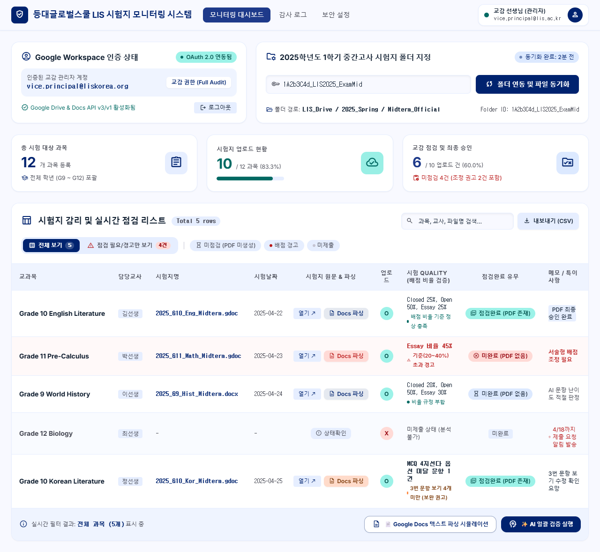

# Inspection Paper (등대글로벌스쿨 LIS 시험지 모니터링 시스템)

Lighthouse International School (LIS) 교감 선생님의 중간/기말고사 시험지 점검 업무를 자동화하고 효율화하는 모니터링 대시보드 웹 애플리케이션입니다.



## 📌 주요 기능 (Core Features)

- **[F1] 학기별 Google Drive 폴더 연동:** 매 학기 변경되는 최상위 시험지 폴더 ID를 입력하고 실시간으로 하위 문서들을 동기화합니다.
- **[F2] 대시보드 매트릭스 테이블:** 폴더 내 모든 교사의 시험지를 한눈에 볼 수 있는 그리드 뷰 및 실시간 검색/필터링을 제공합니다.
- **[F3] Google Docs 원문 텍스트 파싱 & 표지 메타데이터 자동 추출:**
  - `text/plain` 원문 스트림 추출 및 정규식 기반 표지 6대 헤더(Teacher, Date, Subject, Grade, Student Name, Score Sheet) 검출.
  - 배점 합산 및 카테고리(Closed, Open, Essay) 비율 계산 및 가이드라인 비교.
  - 객관식 4지선다(A/B/C/D) 옵션 완성도 검증.
- **[F4] 시험지 링크 직접 접근:** Google Docs/Word 원문 링크 새창 열기.
- **[F5] 점검 완료 유무 자동 확인:** 원본 파일명과 동일한 PDF 파일이 폴더에 존재하는지 확인하여 승인 상태 판정.
- **[F6] Gemini AI 기반 시험지 Quality 검수:** `rules.md` 가이드라인에 따른 문항 분석 및 난이도(Cognitive Load) 평가 리포트 생성.

---

## 🛠️ 기술 스택 (Tech Stack)

- **Backend:** Python 3.12, FastAPI, Uvicorn, Pydantic
- **Frontend:** HTML5, Tailwind CSS, Vanilla JavaScript (Stitch Design 기반)
- **APIs & SDKs:** Google Drive API v3, Google OAuth 2.0, Google GenAI SDK (Gemini Pro)
- **Deployment:** Docker, Google Cloud Run, Render, Railway 지원

---

## 🚀 로컬 실행 방법 (Local Getting Started)

### 1. 가상환경 및 패키지 설치
```bash
python -m venv venv
# Windows:
.\venv\Scripts\activate
# Mac/Linux:
source venv/bin/activate

pip install -r requirements.txt
```

### 2. 환경 변수 설정
`.env.example`을 복사하여 `.env`를 생성합니다:
```bash
cp .env.example .env
```
> **참고:** Google OAuth 키가 없더라도 시스템에 기본 탑재된 **Mock Simulation Mode**를 통해 즉시 모든 대시보드 및 모달 인터랙션을 테스트할 수 있습니다.

### 3. 서버 실행
```bash
python run.py
```
브라우저에서 `http://localhost:3088` 접속.

---

## 🌐 웹 배포 가이드 (Cloud Deployment)

### 옵션 1: Google Cloud Run (권장)
Google Drive API 및 Gemini를 사용하므로 GCP Cloud Run 환경과 가장 잘 연동됩니다.
```bash
# 1. Google Cloud 로그인 및 프로젝트 설정
gcloud auth login
gcloud config set project [YOUR_PROJECT_ID]

# 2. Cloud Run 빌드 및 배포
gcloud run deploy inspection-paper \
  --source . \
  --region asia-northeast3 \
  --allow-unauthenticated \
  --port 3088
```

### 옵션 2: Render / Railway / Docker
1. GitHub 리포지토리(`https://github.com/Kyumunhwang/inspection-paper.git`)를 Render나 Railway에 연동.
2. Build Command: `pip install -r requirements.txt`
3. Start Command: `python run.py`
4. Environment Variables:
   - `PORT`: `3088` (또는 플랫폼 기본 포트)
   - `GOOGLE_CLIENT_ID`, `GOOGLE_CLIENT_SECRET`, `GOOGLE_REDIRECT_URI`
   - `GEMINI_API_KEY`
